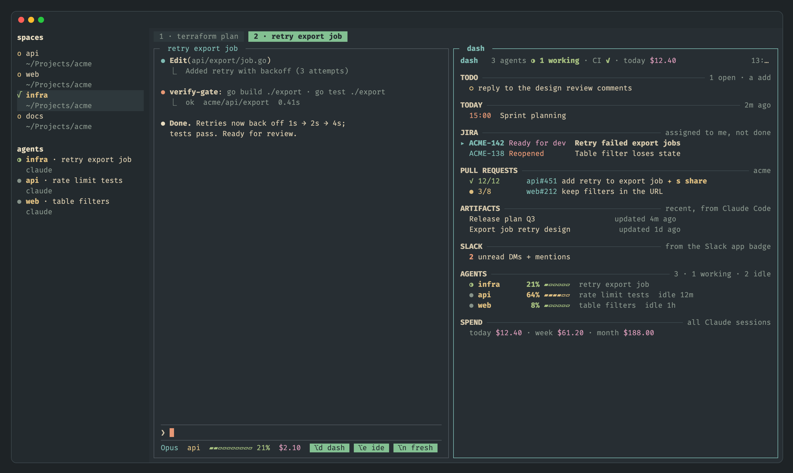
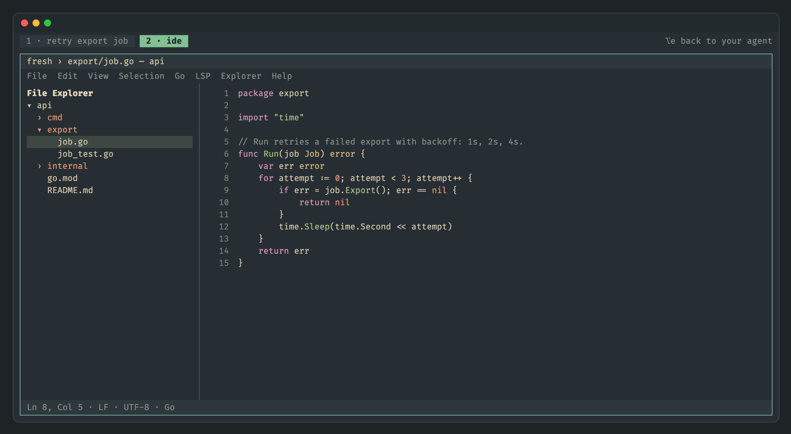
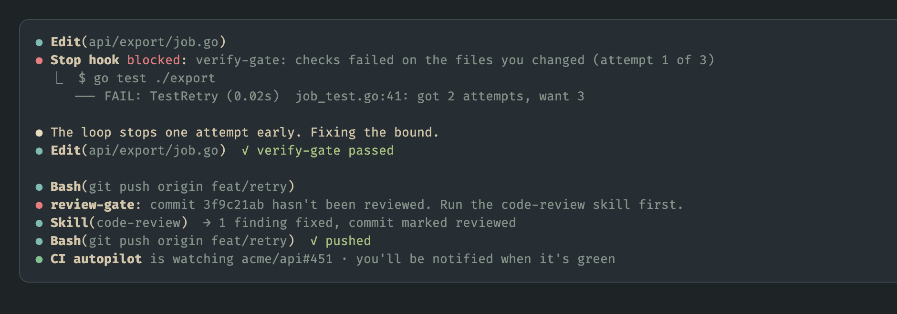
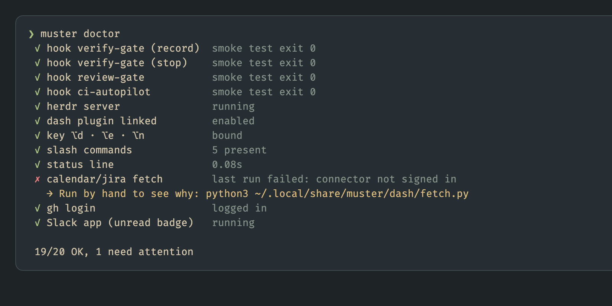

# Muster

**Run a team of Claude Code agents from one terminal, and see everything around them.** Your Jira tickets, pull requests and CI, today's meetings, Slack, artifacts, every agent's context and your spend, one key away. Agents check their own work before they finish, get reviewed before they push, and fix their own red CI.


<sub>Screenshots use sample data.</sub>

## Install: one command

You need a Mac with [Homebrew](https://brew.sh) and [Claude Code](https://claude.com/claude-code). Then:

```bash
gh api repos/amanjain-codes/muster/contents/bootstrap.sh -H "Accept: application/vnd.github.raw" | bash
```

It downloads Muster to `~/.muster`, installs what's missing (Ghostty, herdr, the fresh editor, the IDE plugins, uv, gh, jq, Node, the font) and wires everything up. It backs up every file it touches and never overwrites your own settings. No tokens needed.

**Then, once:**
1. In Claude Code, connect the claude.ai connectors you want: **Google Calendar**, **Atlassian** (Jira), **Slack**.
2. `muster config`: set your GitHub org, your code folder and (optionally) your team's Slack channel.
3. Open Ghostty and press **`⌥d`**.

`muster doctor` checks everything. `muster update` gets the latest version. `muster uninstall` puts your machine back the way it was.

## What you get

- **`dash`**, a dashboard pane on `⌥d`: TODO notes, today's meetings, Jira, your PRs and CI, recent artifacts, Slack unread, every agent's context %, spend, an end-of-day recap, and a health check that speaks up only when something breaks.
- **`⌥e`**: your editor (`fresh`) full screen in its own tab, press again to go back. **`⌥n`**: swap a long Claude session for a fresh one that carries the context over.
- **Quality gates for every agent**: a verify gate (builds and tests what the agent changed before it can say "done") and a review gate (no `git push` of an unreviewed commit).
- **CI autopilot**: after an agent pushes, CI is watched; red goes back to the agent to fix (2 tries), green notifies you.
- **Ticket → agent → worktree → cleanup**: start an agent on a Jira story with one key; clean up worktrees once their PR merges.
- **Slash commands**: `/watch-ci`, `/writeup`, `/tell`, `/learn`, `/handoff`.
- **Share a PR** to your team's Slack channel in one key, in a consistent template.

## Keys

| Key | |
|---|---|
| `⌥d` | the **dash** dashboard, as a split (press again to close) |
| `⌥e` | your editor full screen in its own tab (press again to go back) |
| `⌥n` | fresh Claude session that carries the context over |
| `⌥f` | file viewer: git-aware tree, diffs, rendered Markdown |
| `⌥r` | review the diff of what the agent in this tab changed, beside the chat |

Inside dash: `Tab` moves between sections, `o` opens, `C` hands an item to Claude, `r` refreshes everything. Full list: [docs/USAGE.md](docs/USAGE.md).

## The IDE

`⌥e` opens the [fresh](https://github.com/sinelaw/fresh) editor full screen in its own tab; press again to be back with your agent, unsaved edits intact. With the file viewer (`⌥f`) and diff review (`⌥r`) you read, review and edit without leaving the terminal. Details: [docs/IDE.md](docs/IDE.md).



## Agents that check their own work



## Health check



## Install options

```bash
~/.muster/install.sh --with-ghostty   # replace your Ghostty config with Muster's (yours is backed up)
~/.muster/install.sh --with-theme     # set herdr's matching Everforest theme
~/.muster/install.sh --dry-run        # show what would change, change nothing
```

Without `--with-ghostty`, the installer only adds the one line the `⌥` keys need (`macos-option-as-alt = left`) to your existing Ghostty config.

## Docs

| | |
|---|---|
| [docs/USAGE.md](docs/USAGE.md) | every key, section and command |
| [docs/IDE.md](docs/IDE.md) | editor, file viewer, diff review, and how to change them |
| [docs/ARCHITECTURE.md](docs/ARCHITECTURE.md) | how the pieces fit and where data lives |
| [docs/SPECS.md](docs/SPECS.md) | requirements, design rules, measured speed and cost |
| [docs/IMPROVING.md](docs/IMPROVING.md) | add a section, a check or a command; conventions; tests |
| [docs/SECURITY.md](docs/SECURITY.md) | what runs, what it can touch, what never leaves your machine |
| [docs/TROUBLESHOOTING.md](docs/TROUBLESHOOTING.md) | fixes for the things that go wrong |
| [themes/README.md](themes/README.md) | themes and how to switch |

## Requirements

macOS, Homebrew, Claude Code (signed in), Ghostty, herdr ≥ 0.9.5, uv, gh, jq, Node or Bun (for spend), FiraCode Nerd Font. `install.sh` checks each and offers to install what's missing.

## Tests

`muster test`: 34 checks across the verify gate, review gate, CI autopilot and its hook. Local only: nothing calls GitHub, Slack or Claude.

## Built on

[Ghostty](https://ghostty.org) (terminal), [herdr](https://herdr.dev) (agent workspace, Apache-2.0), [Claude Code](https://claude.com/claude-code), [Textual](https://textual.textualize.io) (dash UI), [ccusage](https://github.com/ryoppippi/ccusage) (spend). Version history: [CHANGELOG.md](CHANGELOG.md).

## License

[MIT](LICENSE). Muster installs third-party tools (herdr, fresh, the herdr plugins, ccusage) from their own sources under their own licenses; it doesn't bundle them.
