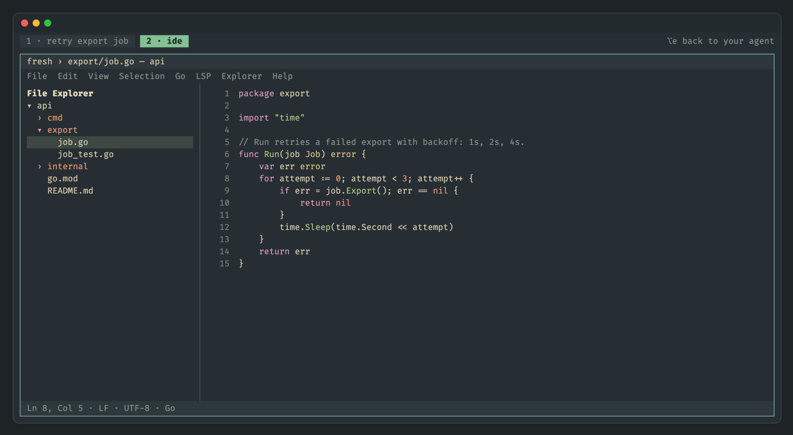

# The Muster IDE

Muster's IDE is five keys around your agents, so you can read, review and edit code without leaving the terminal.

| Key | Opens | Built with |
|---|---|---|
| `⌥e` | **Editor**, full screen in its own `ide` tab; press again to go back to the exact tab you came from | [fresh](https://github.com/sinelaw/fresh) |
| `⌥f` | **File viewer**: git-aware tree, diffs, rendered Markdown, in a split | [herdr-file-viewer](https://github.com/smarzban/herdr-file-viewer) (MIT) |
| `⌥r` | **Review**: the diff of what the agent in this tab changed, beside the chat | [herdr-reviewr](https://github.com/persiyanov/herdr-reviewr) (MIT) |
| `⌥d` | **dash**: tickets, PRs, agents and the rest (see USAGE.md) | Muster |
| `⌥n` | **Fresh session** with the context carried over | Muster |

Tabs are also titled automatically from what each agent is doing ([herdr-auto-title](https://github.com/kryptamine/herdr-auto-title), MIT).

Sample data.

## The editor (`⌥e`)

- **One editor tab per space.** The first `⌥e` creates an `ide` tab in that space and opens `fresh` in the folder you were in. Later presses jump straight to it; press again to return.
- **Your edits survive switching.** `fresh` keeps running in its tab, unsaved buffers included.
- **No surprise agent.** The tab starts from the plugin folder, so plugins that auto-start Claude in new tabs skip it.
- **Limit**: the tab stays in the folder where it was first opened. To edit another project in the same space, quit fresh, close the `ide` tab, and press `⌥e` from the other project.

### fresh setup shipped with Muster

`install.sh` installs `fresh` (`brew install fresh-editor`) and, only if you don't have your own, these files to `~/.config/fresh/`:

| File | What it does |
|---|---|
| `config.json` | VS Code key bindings, the Everforest Dark Hard theme, hidden and git-ignored files visible in the explorer, Vim mode available but off |
| `init.ts` | opens `.md` files rendered instead of raw (`Ctrl+P` → "Markdown: Source Mode" to edit the raw text) |
| `themes/everforest-dark-hard.json` | the theme, matching Ghostty and herdr |

### Keys worth knowing in fresh (VS Code map)

| Key | |
|---|---|
| `Ctrl+P` | command palette: every command, including toggling Vim mode and Markdown modes |
| `Ctrl+E` | show / focus the file explorer |

Everything else follows fresh's VS Code key map; the full list is in fresh's command palette and docs.

Language servers (completion, go-to-definition) are configured in fresh itself; see fresh's documentation. The status bar shows `LSP (off)` until one is set up.

## Reviewing an agent's work (`⌥r`, `⌥f`)

A typical loop:

1. The agent finishes (the **verify gate** has already built and tested what it changed).
2. `⌥r`: read its diff beside the chat. Comment back in the chat if something's off.
3. `⌥f`: browse the tree or open a file's diff in full.
4. `⌥e`: change something by hand.
5. Back in the chat: "commit and push". The **review gate** makes it run a review first; **CI autopilot** watches CI afterwards.

## Changing the IDE

- **Keys**: `~/.config/herdr/config.toml` → `[[keys.command]]` blocks; then `herdr server reload-config`. Update the labels in `~/.claude/statusline-muster.sh` to match.
- **Editor**: replace `fresh` in `~/.local/share/muster/dash/editor.sh` (`fresh .`) with any terminal editor (`nvim .`, `hx .`).
- **Theme**: see [themes/README.md](../themes/README.md); fresh's theme is `"theme"` in `~/.config/fresh/config.json`.
